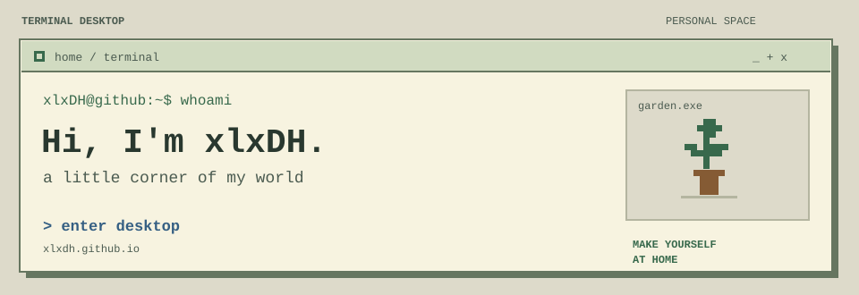

<a href="https://xlxdh.github.io/">
  <picture>
    <source media="(prefers-color-scheme: dark)" srcset="./assets/terminal-dark.svg">
    <source media="(prefers-color-scheme: light)" srcset="./assets/terminal-light.svg">
    
  </picture>
</a>

[进入终端桌面 ↗](https://xlxdh.github.io/) · [浏览全部仓库 ↗](https://github.com/xlxDH?tab=repositories)

### `> cat about.txt`

大家都是亿亿级的生物大模型，总觉得自己会犯错是因为预训练数据太少了，发生了后训练发生灾难性遗忘，再训一下就好了૮₍ ˊᯅˋ₎ა

### `> ls ~/projects`

[**terminal desktop**](https://github.com/xlxDH/xlxDH.github.io) · `JavaScript`  
我的像素终端桌面：用命令浏览项目，闲下来看看自动游玩的小游戏。  
[进入桌面 ↗](https://xlxdh.github.io/)

[**BeiXi**](https://github.com/xlxDH/BeiXi) · `TypeScript`  
与朋友共享位置，让相隔很远的熟悉头像出现在同一张地图上。

[**Newbird-s-papers**](https://github.com/xlxDH/Newbird-s-papers) · `Reading`  
一只 newbird 的论文阅读记录。

### `> open ~/desktop`

```text
visitor@xlxDH:~$ help
  ls       看看我的项目
  whoami   认识一下这个桌面的主人
  theme    换一种明暗
```

上面的命令可以在[个人站](https://xlxdh.github.io/)里实际输入。GitHub 这里是欢迎界面，完整的终端和 `arcade.exe` 在那边。

---

**MAKE YOURSELF AT HOME**  
输入 help，随便逛逛。
